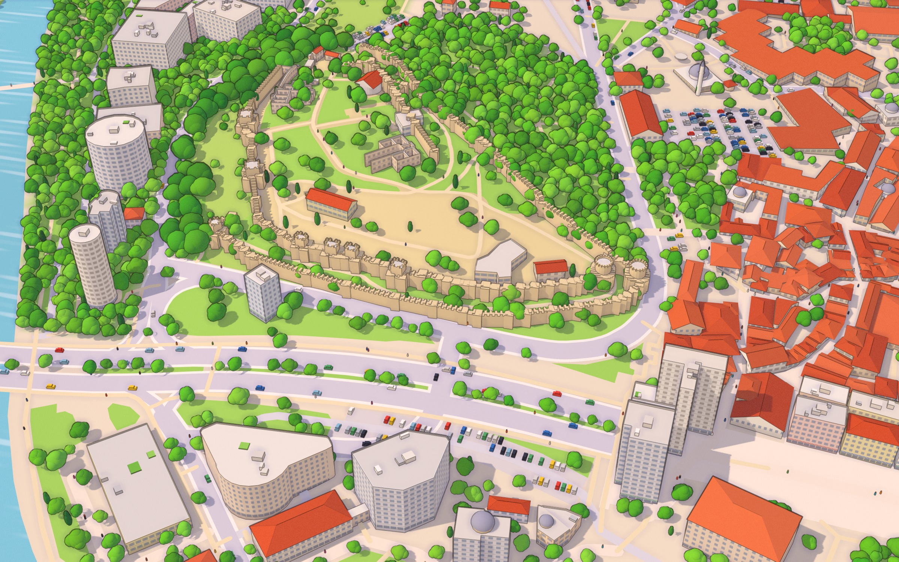

# 091 Скопје



**Live:** https://bbojan.github.io/091-skopje/ — Го добивме 091 Скопје пред GTA 6!

An illustrated, living 3D map of Skopje — from Gjorče Petrov to Gazi Baba and from Butel to the top of Vodno — drawn in real time from OpenStreetMap data on real terrain, in a hand-drawn isometric map style.

Илустрирана, жива 3Д мапа на Скопје, нацртана од отворените податоци на OpenStreetMap.

More towns — **043 Кавадарци** (Kavadarci, the centre of the Tikveš wine region), **097 Битола** (Bitola, the city of consuls under Pelister) **096 Охрид** (Ohrid and Struga with the whole of Lake Ohrid) **098 Прилеп** (Prilep under Markovi Kuli) **048 Крушево** (Kruševo, the town of the Ilinden Uprising) **033 Македонска Каменица** (Makedonska Kamenica, the miners' town under Osogovo) **034 Дојран** (Dojran and the whole of Lake Dojran) **02 Батинци** (Batinci and its surroundings south of Skopje, to Marko's Monastery) **033 Берово** (Berovo, Pehčevo and the whole of Berovo Lake) **094 Тетово** (Tetovo, Gostivar and the Šar Mountains) **045 Македонски Брод** (Makedonski Brod, Lake Kozjak and the Treska) **047 Ресен** (Resen and the whole of Lake Prespa) **02 Матка** (the Matka Canyon and the land west of Skopje) **046 Вевчани** (Vevčani and Drimkol under Jablanica) **0903 Кочани** (Kočani and the rice fields of its plain), **047 Меџитлија** (southern Pelagonia at the Greek border) **031 Кратово – Ѕинго Land** (Kratovo in its volcanic crater, with its towers and stone bridges), **092 Штип** (Štip on the Bregalnica under Isar), **0902 Струмица** (Strumica and its plain), **043 Неготино** (Negotino, the wine town on the Vardar), **043 Демир Капија** (Demir Kapija, its gorge and its wineries) **046 Голо Брдо** (Peshkopi and the Black Drin valley in Albania; built, not released yet) and **033 Виница** (Vinica and Vinica fortress, where the terracotta icons were found; built, not released yet) **042 Кораб** (Korab, the highest peak, its waterfall and Gorna Reka; built, not released yet) **032 Пробиштип** (Probištip, Zletovo's mines, Lesnovo Monastery and Kočani Lake; built, not released yet) — are chosen from the badge at the top left or opened directly with `?city=`: https://bbojan.github.io/091-skopje/?city=kavadarci, https://bbojan.github.io/091-skopje/?city=bitola, https://bbojan.github.io/091-skopje/?city=ohrid, https://bbojan.github.io/091-skopje/?city=rostuse, https://bbojan.github.io/091-skopje/?city=prilep, https://bbojan.github.io/091-skopje/?city=krusevo, https://bbojan.github.io/091-skopje/?city=kamenica, https://bbojan.github.io/091-skopje/?city=dojran, https://bbojan.github.io/091-skopje/?city=batinci, https://bbojan.github.io/091-skopje/?city=berovo, https://bbojan.github.io/091-skopje/?city=tetovo, https://bbojan.github.io/091-skopje/?city=brod, https://bbojan.github.io/091-skopje/?city=resen, https://bbojan.github.io/091-skopje/?city=matka, https://bbojan.github.io/091-skopje/?city=vevcani, https://bbojan.github.io/091-skopje/?city=kocani, https://bbojan.github.io/091-skopje/?city=medzitlija, https://bbojan.github.io/091-skopje/?city=kratovo, https://bbojan.github.io/091-skopje/?city=stip, https://bbojan.github.io/091-skopje/?city=strumica, https://bbojan.github.io/091-skopje/?city=negotino, https://bbojan.github.io/091-skopje/?city=demirkapija

## Features

**The city**
- ~20,000 buildings on real terrain (Vardar valley, Kale, Vodno) with procedural windows, shutters, awnings, cornices, tiled roofs and parapets
- Landmarks: Warrior on a Horse, Stone Bridge, Porta Macedonia, Kale with its towers, the Millennium Cross, the Vodno gondola, the railway station (Kenzo Tange), with labels for the Old Bazaar, Daut Pasha Hamam, Св. Спас, the Telecommunications Centre, City Mall and more
- ~430k cartoon trees, parked cars and live traffic: cars, red ЈСП buses (half double-deckers) and pedestrians
- Ink outlines, soft ambient occlusion and temporal supersampling for smooth edges

**Kavadarci** (`?city=kavadarci`)
- The town with Ваташа, Глишиќ, the Луда Мара and Катунишко Езеро (≈ 8.7 × 9.1 km), on real terrain
- Hand-built monuments modelled after photos and descriptions: the Memorial Ossuary (Petar Muličkovski, 1976), the People's Heroes Kiro Krstev and Dimče Mirčev, the Vataša memorial at Moklište, the Monument to the Revolution on the square
- Плоштад Маршал Тито as it looks in 2020–2025 (the town hall, fountains, planters, bollards) and the Дом на културата, which OSM lacks, placed from its building plans
- Its own places, labels, race route (10 rings), walking info cards; firefighting refills from Тиквешко Езеро

**Bitola** (`?city=bitola`)
- The town in the Pelagonia plain with Хераклеа Линкестис, the villages on the slopes of Баба and Pelister (2601 m) with its two glacial lakes, on real terrain
- Hand-built monuments after photos: the Clock Tower (32 m), the Ajdar Kadi Mosque, the Bezisten, the cathedral of St. Demetrius and its bell tower, the Roman theatre and the Great Basilica with its mosaic floors at Heraclea
- Walk as **Милтон Манаки**, the Balkans' first film-maker, with his hand-cranked camera: 🎥 film the people dancing an оро
- Its own places, labels, race route (12 rings over the town, Heraclea and Pelister), walking info cards; firefighting refills from the Драгор or Големо Езеро; no ЈСП buses

**Ohrid** (`?city=ohrid`)
- The whole of Lake Ohrid (≈ 19 × 35 km): Ohrid and Struga, Св. Наум, the villages on both shores and Pogradec on the Albanian side, Galičica to the east, on real terrain
- Hand-built monuments after photos: St. John at Kaneo, St. Clement and Panteleimon at Plaošnik with its bell tower, St. Sophia with its two-storey gallery, the church of St. Naum, the ancient theatre, and the pile dwellings of the Bay of Bones out on the water; Samuel's Fortress from OSM's walls
- Its own places, labels, race route (12 rings round the lake), walking info cards; firefighting refills anywhere over the lake; no ЈСП buses

**Rostuše** (`?city=rostuse`)
- The Mijak country (≈ 27 × 37 km): Rostuše in the Radika valley, Debar and Debar Lake, Lake Mavrovo in the national park, Galičnik on Bistra, on real terrain
- The **Bigorski Monastery** built in detail after photos: konaks with jutting timber storeys and stone-slab roofs, the bell tower with its belvedere, the church with its drum, the gate portico and the fountain pavilion; the sunken church of St. Nicholas at Mavrovo
- Its own places, labels, race route (11 rings), walking info cards; firefighting refills from Lake Mavrovo or Debar Lake; no ЈСП buses

**Prilep** (`?city=prilep`)
- The town of tobacco in the Pelagonia plain, Markovi Kuli on its granite hill, Treskavec under Zlatovrv, Prilep Lake, on real terrain
- Hand-built after photos: the Clock Tower, the Mound of the Unbeaten (Bogdan Bogdanović) with its stone urns, the boulders of Markovi Kuli, Treskavec's church
- Its own places, labels, race route (11 rings), walking info cards; firefighting refills from Prilep Lake; no ЈСП buses

**Kruševo** (`?city=krusevo`)
- The highest town in Macedonia on the slopes of Buševa Planina, its white houses with red roofs, the forests round it, on real terrain
- Hand-built after photos: the Makedonium (Jordan and Iskra Grabul, 1974) with its stained-glass windows, the giant of Mečkin Kamen
- Its own places, labels, race route (8 rings), walking info cards; firefighting refills from Kruševo Lake; no ЈСП buses

**Makedonska Kamenica** (`?city=kamenica`)
- The miners' town in the valley of the Kamenička Reka under Osogovo, the Sasa lead and zinc mine up the valley, Lake Kalimanci on the Bregalnica, on real terrain
- Hand-built after photos: the church of the Dormition on the town square, the square's fountain with its statue
- Its own places, labels, race route (12 rings), walking info cards; firefighting refills from Lake Kalimanci; no ЈСП buses

**Dojran** (`?city=dojran`)
- The whole of Lake Dojran: Star Dojran and Nov Dojran on the west shore, Kale Tepe, the Greek shore with Doirani, on real terrain
- Hand-built after photos: the clock tower, St. Elijah's basilica (1848), a mandra — the lake's reed fishing enclosure with its hut on stilts
- Its own places, labels, race route (12 rings), walking info cards; firefighting refills from the lake; no ЈСП buses

**Batinci** (`?city=batinci`)
- Batinci and its surroundings south of Skopje's map: Pintija, Dračevo, Dolno Količani and Marko's Monastery along the Markova Reka valley, on real terrain
- Hand-built after photos: Marko's Monastery, the church of St. Demetrius (14th century)
- Its own places, labels, race route (10 rings), walking info cards; firefighting refills from the Markova Reka; no ЈСП buses

**Berovo** (`?city=berovo`)
- The Maleševo basin: Berovo, Ratevo and Smojmirovo, Pehčevo to the north, the whole of Berovo Lake and the Spikovo waterfalls, on real terrain
- Hand-built after photos: the church of St. Michael the Archangel (1818) with its porch and bell tower, the church of the Nativity of the Theotokos on the square, the arch dam of the lake
- Its own places, labels, race route (11 rings), walking info cards; firefighting refills from the lake; no ЈСП buses

**Tetovo** (`?city=tetovo`)
- The Polog valley under the Šar Mountains: Tetovo, Gostivar, the source of the Vardar at Vrutok, Popova Šapka, Titov Vrv and the glacial lakes, on real terrain
- Hand-built after photos: the Painted Mosque, Gostivar's clock tower, the church of the Lešok Monastery, the walls of Tetovo Fortress
- Its own places, labels, race route (11 rings), walking info cards; firefighting refills from the Vardar; no ЈСП buses

**Makedonski Brod** (`?city=brod`)
- Poreče along the Treska: Makedonski Brod, the Pešna cave, the Zrze Monastery, the whole of Lake Kozjak and the Sveta Petka reservoir, Solunska Glava on Jakupica, on real terrain
- Hand-built after photos: the church of the Zrze Monastery, the Sveta Petka arch dam
- Its own places, labels, race route (11 rings), walking info cards; firefighting refills from the lakes; no ЈСП buses

**Resen** (`?city=resen`)
- Prespa: Resen, the whole of Lake Prespa with its Albanian and Greek shores, the island of Golem Grad, Kurbinovo, and Small Prespa, on real terrain
- Hand-built after photos: the Resen Saray (the palace of Niyazi Bey), the churches of St. Peter on Golem Grad and St. George in Kurbinovo
- Its own places, labels, race route (11 rings), walking info cards; firefighting refills from the lake; no ЈСП buses

**Matka** (`?city=matka`)
- The Matka Canyon with its lake and dam, Saraj's villages and Suva Gora west of Skopje, on real terrain; the first map that is not a rectangle (Skopje's and Brod's maps are cut out of it)
- Hand-built after photos: the churches of St. Andrew and St. Nicholas of Šiševo, the Matka arch dam
- Its own places, labels, race route (12 rings), walking info cards; firefighting refills from Lake Matka or Lake Treska; no ЈСП buses

**Vevčani** (`?city=vevcani`)
- Drimkol: Vevčani and its springs, Labunište, Podgorci, Belica, Trebeništa, Lake Globočica and the Jablanica ridge on the Albanian border, on real terrain; Ohrid's map is cut out of it
- Hand-built after photos: the church of St. Nicholas, wooden footbridges over the stream below the springs
- Its own places, labels, race route (12 rings), walking info cards; firefighting refills from Lake Globočica; no ЈСП buses

**Kočani** (`?city=kocani`)
- Kočani and its plain: the rice paddies along the Bregalnica (green in summer, flooded in spring, golden in autumn), Obleševo, Zrnovci and the slopes of Plačkovica, on real terrain
- Hand-built after photos: the two Ottoman towers (the medieval tower and the clock tower), the Monument to Freedom on Lokubija with its mosaics
- Its own places, labels, race route (12 rings), walking info cards; firefighting refills from the Bregalnica; no ЈСП buses

**Medžitlija** (`?city=medzitlija`)
- Southern Pelagonia under Bitola's map down to the Greek border: Medžitlija and the border crossing, Kremenica and its railway station, the villages under Baba and the first villages of the Florina plain, on real terrain
- Hand-built after photos and the aerial image: the mosque of Medžitlija, the canopies of the border crossing (both sides), the Velušina monastery (church, bell tower, konak)
- Its own places, labels, race route (13 rings), walking info cards; firefighting refills from the fish ponds by Žabeni; no ЈСП buses

**Kratovo** (`?city=kratovo`, built by Branko Slavkov)
- Kratovo in the crater of an extinct volcano, the Kratovo river, Kneževo lake on the Zletovica, the stone dolls of Kuklica, the villages of Slavište with Rankovce and Petralica up to the Serbian border, on real terrain
- Hand-built after descriptions: the six medieval towers (Simić's, the clock tower, Zlatkovič's, Krste's, Hadži-Kosta's, Emin-bey's), the stone bridges (Rada's, Grofčanski, Čaršijski, Jokširski and three more), the earth pyramids of Kuklica, Hotel Kratis, Dzingo's house with a mural, and a Hollywood-style „ЅИНГО LAND“ sign on the hill as a joke
- Its own places, labels, race route (13 rings), walking info cards; firefighting refills from Kneževo lake; no ЈСП buses

**Štip** (`?city=stip`, built by Kalina Jovanovska)
- Štip and the Bregalnica valley: the Isar fortress above the town, the Bezisten, the old churches of Novo Selo, the ancient town of Bargala by Kozjak, Karbinci and the villages down to Lakavica, on real terrain
- Its own places, labels, race route (14 rings), walking info cards; firefighting refills from the Bregalnica; no ЈСП buses

**Strumica** (`?city=strumica`, built by Kalina Jovanovska)
- Strumica and the Strumica plain: Carevi Kuli above the town, the monasteries of Vodoča and Veljusa, Vodoča lake and Mantovo, the fields of the plain and the villages to Konče, on real terrain
- Its own places, labels, race route (14 rings), walking info cards; firefighting refills from Vodoča lake and Mantovo; no ЈСП buses

**Negotino** (`?city=negotino`, built by Riste Samardžiev)
- Negotino and the middle Vardar valley: the town, its vineyards, Krivolak, Pepelište, Dubrovo and the villages to Lipa and Piperovo, the Vardar's bends, on real terrain
- Hand-built after photos: Negotino monastery of St George and its bell tower, the church of St Athanasius the Great, the Negotino power plant's chimney and fuel tanks
- Its own places, labels, race route (14 rings), walking info cards; firefighting refills from the Vardar; no ЈСП buses

**Demir Kapija** (`?city=demirkapija`, built by Riste Samardžiev)
- Demir Kapija at the mouth of its gorge on the Vardar, the vineyards round the town and in the Bošava valley, Krnjevo, up to the Kožuf ski centre, on real terrain
- Hand-built after photos and the aerial image: the Popova Kula winery (stone tower with the tasting room, arcade, hotel wings), the royal winery Queen Maria (Villa Maria with its caryatids and peacocks, the old royal cellar, the tank yard, the amphitheatre), Hotel Verdisso and its pool
- Its own places, labels, race route (13 rings, the wine road), walking info cards; firefighting refills from the Vardar; no ЈСП buses

**Golo Brdo** (`?city=golobrdo`)
- The Black Drin valley west of Debar, almost all of it Albania: Peshkopi, Maqellarë and the Blato border crossing, the villages of Dibër and the north of Golo Brdo (Gollobordë) with Ostren, on real terrain
- Hand-built after photos: the Allajbegi Mosque in Burim (before 1578), the church of the Transfiguration in Herbel
- Its own places, labels, race route (15 rings), walking info cards; firefighting refills from the Black Drin; no ЈСП buses

**Vinica** (`?city=vinica`, built, not released yet)
- The east end of the Kočani valley: Vinica, the Bregalnica and its rice paddies, Istibanja and its lake, Blatec under Plačkovica and the hills toward Delčevo, on real terrain
- Hand-built after its description: the ruins of Vinica fortress (Viničko Kale), where the terracotta icons were found
- Its own places, labels, race route (15 rings), walking info cards; firefighting refills from the Bregalnica and Istibanja lake; no ЈСП buses

**Korab** (`?city=korab`, built, not released yet)
- Golem Korab (2764 m), the highest peak of Macedonia, the Korab waterfall, the upper Radika with the villages of Gorna Reka and the border ridge of Šar Planina, on real terrain; bare alpine pastures above the tree line
- Its own places, labels, race route (15 rings), walking info cards; firefighting refills from the Radika; no ЈСП buses

**Probištip** (`?city=probistip`, built, not released yet)
- Probištip and Zletovo with the lead and zinc mine, Lesnovo Monastery (its church hand-built), the Zletovica, Kočani Lake behind the Gratče dam and Ponikva on Osogovo, on real terrain
- Its own places, labels, race route (15 rings), walking info cards; firefighting refills from Kočani Lake; no ЈСП buses

**Time, weather and seasons**
- Day, sunset and night (lit windows, street lamps, headlights), drifting clouds, birds, paragliders over Vodno, flowing river
- Weather: clear, rain (wet streets, puddles, umbrellas), snow, or snow only on Vodno
- Seasons: summer, autumn colours, bare winter trees, spring blossom — the default follows the month

**Things to do**
- 🚶 Walk the city as **Итар Пејо** or a **Шарпланинец** dog, in first or third person: board a bus, ride the gondola to Vodno, take off in the plane, start an оро, or bark; info cards at the landmarks
- 🚌 Drive a red ЈСП double-decker through the streets
- ✈ Fly a Macedonian-flag light aircraft, with an optional ring race and 091 balloons
- 🔥 Fight fires in a yellow Air Tractor: forest, building and bus fires, water drops, refills from the Vardar
- 🔊 Optional sound (off by default): engine, water and fire, rain, birds and crickets, all synthesised in the browser
- Your choices are remembered in the browser (time of day, weather, season, quality, language and the other options)
- 🔗 Shareable links: the city (`?city=`) and the camera position are always in the address bar

**For every screen**
- Interface in Macedonian, English, Serbian, Croatian, Slovenian and Albanian (map names stay Macedonian), in a Вез (folk embroidery) style; help dialog behind the 091 logo
- Mouse, touch, keyboard and gamepad (XInput / DirectInput) controls
- Phone and tablet layout; automatic low-quality mode for slow devices, a smooth-edges switch (off is faster), a less-traffic option, and a memory saver (on by default on phones); long menus wrap into two columns on short screens

More context for development (architecture, conventions, decisions, gotchas):
[CLAUDE.md](CLAUDE.md) and [docs/NOTES.md](docs/NOTES.md); adding another city: [docs/ADDING_A_CITY.md](docs/ADDING_A_CITY.md).

## Run locally

```bash
npm install
npm run dev
```

## Build

```bash
npm run typecheck   # TypeScript 7, strict
npm run build   # static site in dist/ (relative paths, works on GitHub Pages)
```

Pushing to `main` deploys to GitHub Pages via `.github/workflows/deploy.yml`.

## Regenerate the data

The prepared data in `public/` is committed. To rebuild it (extents in `scripts/config.ts`; the city is
the first argument, Skopje when left out):

```bash
npm run download   # OpenStreetMap via Overpass → data/skopje_raw.json
npm run terrain    # elevation tiles → public/terrain.bin
npm run data       # → public/skopje.json
npm run download -- kavadarci && npm run terrain -- kavadarci && npm run data -- kavadarci
                   # → public/kavadarci.json, public/kavadarci-terrain.bin/.json
npm run download -- bitola && npm run terrain -- bitola && npm run data -- bitola
                   # → public/bitola.json, public/bitola-terrain.bin/.json
npm run download -- ohrid && npm run overture -- ohrid && npm run terrain -- ohrid && npm run data -- ohrid
                   # → public/ohrid.json, public/ohrid-terrain.bin/.json (20 m cells)
npm run download -- rostuse && npm run overture -- rostuse && npm run terrain -- rostuse && npm run data -- rostuse
npm run download -- prilep && npm run overture -- prilep && npm run terrain -- prilep && npm run data -- prilep
npm run download -- krusevo && npm run overture -- krusevo && npm run terrain -- krusevo && npm run data -- krusevo
npm run download -- kamenica && npm run overture -- kamenica && npm run terrain -- kamenica && npm run data -- kamenica
npm run download -- dojran && npm run overture -- dojran && npm run terrain -- dojran && npm run data -- dojran
npm run download -- batinci && npm run overture -- batinci && npm run terrain -- batinci && npm run data -- batinci
npm run download -- berovo && npm run overture -- berovo && npm run terrain -- berovo && npm run data -- berovo
npm run download -- tetovo && npm run overture -- tetovo && npm run terrain -- tetovo && npm run data -- tetovo
npm run download -- brod && npm run overture -- brod && npm run terrain -- brod && npm run data -- brod
npm run download -- resen && npm run overture -- resen && npm run terrain -- resen && npm run data -- resen
npm run download -- matka && npm run overture -- matka && npm run terrain -- matka && npm run data -- matka
npm run download -- vevcani && npm run overture -- vevcani && npm run terrain -- vevcani && npm run data -- vevcani
npm run download -- kocani && npm run terrain -- kocani && npm run data -- kocani   # Overture adds nothing here
npm run download -- medzitlija && npm run overture -- medzitlija && npm run terrain -- medzitlija && npm run data -- medzitlija
npm run download -- kratovo && npm run terrain -- kratovo && npm run data -- kratovo   # Overture adds nothing here
npm run download -- stip && npm run terrain -- stip && npm run data -- stip   # Overture not used here
npm run download -- strumica && npm run overture -- strumica && npm run terrain -- strumica && npm run data -- strumica
npm run download -- negotino && npm run overture -- negotino && npm run terrain -- negotino && npm run data -- negotino
npm run download -- demirkapija && npm run overture -- demirkapija && npm run terrain -- demirkapija && npm run data -- demirkapija
npm run overture -- golobrdo && npm run terrain -- golobrdo && npm run data -- golobrdo   # raw file: pbf2overpass.py with the Albanian extract
npm run overture -- vinica && npm run terrain -- vinica && npm run data -- vinica   # raw file: pbf2overpass.py (Overpass too slow that day)
npm run overture -- korab && npm run terrain -- korab && npm run data -- korab   # raw file: pbf2overpass.py with the Macedonian, Albanian and Kosovo extracts
npm run terrain -- probistip && npm run data -- probistip   # raw file: pbf2overpass.py (Overture has no footprints there)
                   # when Overpass is down: scripts/pbf2overpass.py writes data/<city>_raw.json from Geofabrik extracts
```

## Credits

- Map data © [OpenStreetMap](https://www.openstreetmap.org/copyright) contributors (ODbL)
- Elevation: [Terrain Tiles](https://registry.opendata.aws/terrain-tiles/) on AWS Open Data
- Built with [three.js](https://threejs.org) and TypeScript by [Бојан Божиновски](https://www.linkedin.com/in/bojanb/)
