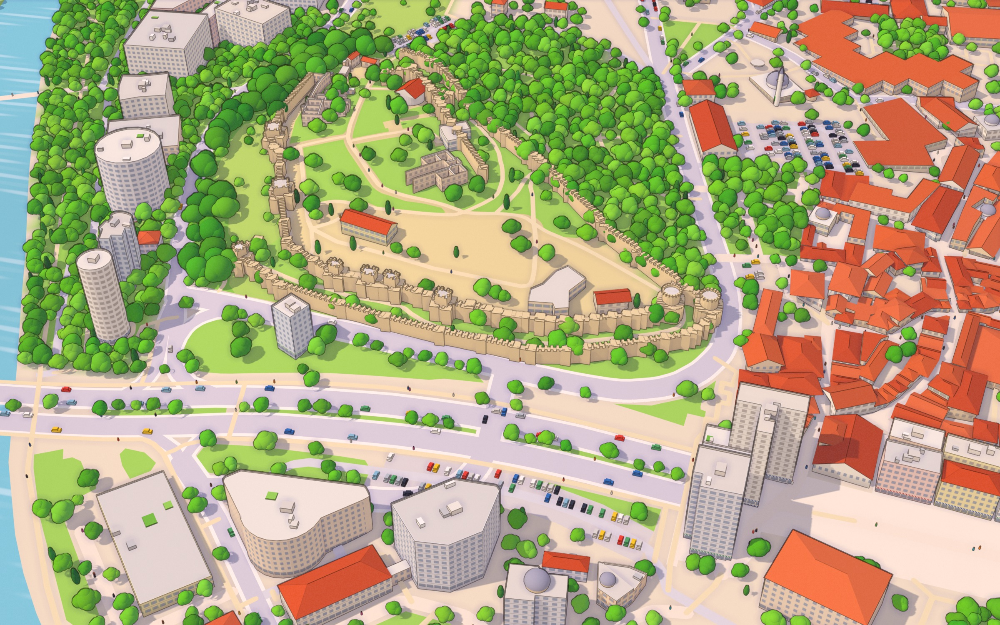

# 091 Скопје



**Live:** https://bbojan.github.io/091-skopje/ — Го добивме 091 Скопје пред GTA 6!

An illustrated, living 3D map of Skopje — from Gjorče Petrov to Gazi Baba and from Butel to the top of Vodno — drawn in real time from OpenStreetMap data on real terrain, in a hand-drawn isometric map style.

Илустрирана, жива 3Д мапа на Скопје, нацртана од отворените податоци на OpenStreetMap.

## Features

- ~20,000 buildings on real terrain (Vardar valley, Kale, Vodno) with procedural windows, shutters, awnings, cornices, tiled roofs and parapets
- Landmarks: Warrior on a Horse, Stone Bridge, Porta Macedonia, Kale with its towers, the Millennium Cross, the Vodno gondola
- ~430k cartoon trees, parked cars and live traffic: cars, buses and pedestrians
- Day, sunset and night (lit windows, street lamps, headlights), drifting clouds, birds, flowing river
- Ink outlines, soft ambient occlusion and temporal supersampling for smooth edges
- ✈ Airplane mode in a Macedonian-flag light aircraft, with an optional ring race and 091 balloons
- Mouse, touch, keyboard and gamepad (XInput / DirectInput) controls
- Macedonian UI in a Вез (folk embroidery) style, place labels, help dialog (click the 091 logo)
- Phone and tablet layout with a lighter memory profile

More context for development (architecture, conventions, decisions, gotchas):
[CLAUDE.md](CLAUDE.md) and [docs/NOTES.md](docs/NOTES.md).

## Run locally

```bash
npm install
npm run dev
```

## Build

```bash
npm run typecheck   # TypeScript 7, strict
npm run build   # static site in dist/ (relative paths, works on GitHub Pages)
```

Pushing to `main` deploys to GitHub Pages via `.github/workflows/deploy.yml`.

## Regenerate the data

The prepared data in `public/` is committed. To rebuild it (extent in `scripts/config.ts`):

```bash
npm run download   # OpenStreetMap via Overpass → data/skopje_raw.json
npm run terrain    # elevation tiles → public/terrain.bin
npm run data       # → public/skopje.json
```

## Credits

- Map data © [OpenStreetMap](https://www.openstreetmap.org/copyright) contributors (ODbL)
- Elevation: [Terrain Tiles](https://registry.opendata.aws/terrain-tiles/) on AWS Open Data
- Built with [three.js](https://threejs.org) by [Бојан Божиновски](https://www.linkedin.com/in/bojanb/)
