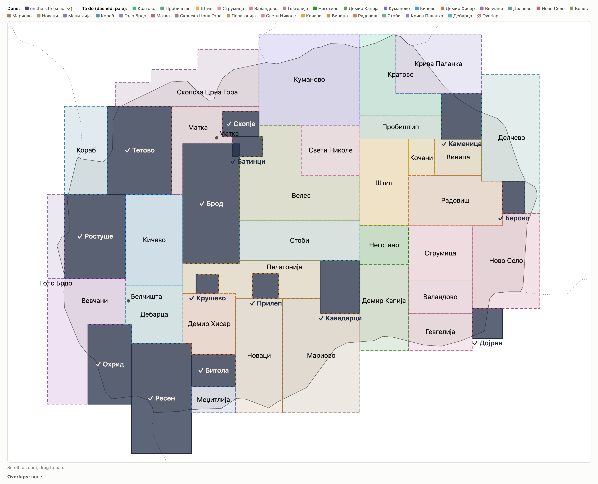

# Towns to do

**Finished: 14 maps on the site** (v14.0.1, 2026-11-21): 091 Скопје, 043 Кавадарци, 097 Битола,
096 Охрид (with Струга), 048 Прилеп, 098 Крушево, 042 Ростуше (with Дебар and Маврово),
033 Македонска Каменица (with Саса), 034 Дојран, 02 Батинци, 033 Берово (with Пехчево), 094 Тетово (with Гостивар),
045 Македонски Брод, 047 Ресен. Details in the first table below.



The map is drawn by [scripts/towns-map.html](../scripts/towns-map.html) (d3 from a CDN; the boxes are typed in
by hand: move a town from `planned` to `existing` when it is built; `cuts` holds the corners a planned map leaves
out where a neighbour already is, `shapes` the full outline of a map that is not a rectangle with cut corners,
`labelAt` where a name goes when the box's middle is not on the map; the line under the map lists overlaps). With `npm run dev` running:

```bash
"/Applications/Google Chrome.app/Contents/MacOS/Google Chrome" --headless=new --disable-gpu --hide-scrollbars --force-device-scale-factor=2 --window-size=1640,1330 --virtual-time-budget=8000 --screenshot=docs/towns-map.png http://localhost:5173/scripts/towns-map.html
```

**To do: 30 new maps**, all edge to edge, no overlaps, the whole country covered. Largest first (km², official
towns on it):

| Map | ~km² | Towns | | Map | ~km² | Towns |
|---|---|---|---|---|---|---|
| Куманово | 1790 | Куманово | | Кораб* | 740 | — |
| Мариово* | 1640 | — | | Пелагонија* | 730 | — |
| Велес | 1540 | Велес | | Струмица | 690 | Струмица |
| Вевчани | 1350 | — | | Дебарца | 630 | — |
| Делчево | 1310 | Делчево | | Демир Хисар | 620 | Демир Хисар |
| Ново Село* | 1190 | — | | Свети Николе | 580 | Свети Николе |
| Скопска Црна Гора* | 1180 | — | | Матка* | 530 | — |
| Новаци* | 1060 | — | | Гевгелија | 470 | Гевгелија, Богданци |
| Кичево | 1030 | Кичево | | Валандово | 410 | Валандово |
| Крива Паланка | 1000 | Крива Паланка | | Пробиштип | 380 | Пробиштип |
| Стоби* | 940 | — | | Неготино | 370 | Неготино |
| Радовиш | 900 | Радовиш | | Виница | 340 | Виница |
| Штип | 820 | Штип | | Голо Брдо* | 280 | — |
| Демир Капија | 820 | Демир Капија | | Меџитлија* | 230 | — |
| Кратово | 750 | Кратово | | Кочани | 190 | Кочани |

\* working names. Only Гевгелија holds two towns now (Богданци is next to it). For comparison, the largest finished
maps are Брод and Ресен (about 1320 km² each); areas include the parts across the borders.

**Cut corners.** Where two maps would overlap, the newer map leaves the corner out (an outline with 90° corners).
In the app a map is still one rectangle (download tiles, terrain grid, chunks): when such a map is built, its
terrain stays the full rectangle and `prepare.ts` drops every OSM feature in the cut rectangles (a `cut` list in
`scripts/config.ts`, to add then), so the corner shows bare relief, as outside a map. The cuts so far:
Дебарца (Охрид's corner), Демир Хисар (Ресен's), Ново Село (Радовиш's), Мариово (Кавадарци's), Вевчани (all of Охрид's
map: Вевчани is an L around its north-west), Делчево (Берово's and Радовиш's), Радовиш (Делчево's), Кратово (Крива Паланка's).
Велес, Матка and Пелагонија are not rectangles with one corner cut but outlines that go around several maps
(`shapes` in the plan page); in the app they would be their bounding rectangle with those maps cut out.

Planned with the owner on 2026-11-21 and redrawn on 2026-11-23, when every part of the country got a map and the
widened Скопје was given up for the Матка map. Кратово is next in the list. How to build one:
[ADDING_A_CITY.md](ADDING_A_CITY.md).

Coordinates are approximate, written from memory while planning: **check every point in OSM before
drawing a bbox**. Badge codes are the owner's own choice, not always the phone code (Bitola 097,
Ohrid 096, Prilep 048, Kruševo 098): ask for each one when it is started.

## Finished (14 maps, all on the site)

| Map | Also on it | `?city=` | bbox (s, w, n, e) |
|---|---|---|---|
| 091 Скопје | — | — | 41.955, 21.33, 42.055, 21.525 |
| 043 Кавадарци | Тиквешко Езеро | `kavadarci` | 41.25, 21.85, 41.462, 22.062 |
| 097 Битола | Хераклеа | `bitola` | 40.955, 21.165, 41.085, 21.40 |
| 096 Охрид | Струга, the whole lake | `ohrid` | 40.885, 20.615, 41.205, 20.845 |
| 048 Прилеп | Маркови Кули, Трескавец | `prilep` | 41.31, 21.49, 41.41, 21.63 |
| 098 Крушево | — | `krusevo` | 41.33, 21.19, 41.405, 21.31 |
| 042 Ростуше | Бигорски, Дебар, Маврово | `rostuse` | 41.39, 20.49, 41.725, 20.815 |
| 033 Македонска Каменица | Саса, Калиманци | `kamenica` | 41.945, 22.495, 42.125, 22.71 |
| 034 Дојран | the whole lake | `dojran` | 41.15, 22.66, 41.27, 22.82 |
| 02 Батинци | Марков манастир | `batinci` | 41.875, 21.385, 41.955, 21.545 |
| 033 Берово | Пехчево, Беровско Езеро | `berovo` | 41.65, 22.82, 41.778, 22.94 |
| 094 Тетово | Гостивар, Вруток, Шар Планина | `tetovo` | 41.725, 20.72, 42.075, 21.06 |
| 045 Македонски Брод | Козјак, Света Петка, Зрзе, Солунска Глава | `brod` | 41.45, 21.12, 41.926, 21.42 |
| 047 Ресен | the whole of Преспа, Голем Град, Мала Преспа | `resen` | 40.685, 20.845, 41.13, 21.165 |

## Planned maps

### 1. 094 Тетово — built (v14.0.0)

- **Built** with n moved to 42.075 (Лешочки манастир at 42.067 N). Not done from the plan below: the ski lifts
  (aerialways), Арабати Баба Теќе as a model, the LinkedIn developer (the default link for now).

- **On it:** Тетово, Гостивар, Вруток, Шар Планина (Попова Шапка, Титов Врв).
- **Code:** **094** (decided). `?city=tetovo`, released in v14.0.1.
- **Extent:** **edge to edge with Ростуше** (decided): s = 41.725 (Rostuše's n). Draft: s 41.725,
  w ~20.72, n ~42.06, e ~21.06 (about 37 × 28 km), 20 m cells, `smooth: 1` (as Rostuše).
  Љуботен (42.19 N) is left out.
- **Landmarks:** Шарена џамија (painted façade), Арабати баба теке, Тетовско кале, Лешочки манастир;
  Гостивар's clock tower; the source of the Вардар at Вруток (springs, pools), ХЕЦ Вруток;
  Попова Шапка (ski lifts, hotels), Титов Врв, glacial lakes (Боговињско Езеро, `waterLevels`).
- **Per city:** `snowLabel` „снег на Шар“; the Шарпланинец companion is at home here; refill at the Вардар
  source and the glacial lakes; banners e.g. „Шар Планина го спаси Тетово!“ / „Поздрав од Полог!“.
- **Data:** ski lifts need aerialways (Skopje's gondola is a separate download, `data/aerialway.json`);
  Overture outlines for the Полог villages.
- **Open:** landmark priorities, the developer for the LinkedIn button.

### 2. Кратово

- **On it:** Кратово, Кратовска Река, the crater's hills up to the border.
- **Code:** open (phone codes 031 / 032). `?city=kratovo`.
- **Extent:** Kratovo 42.08 N 22.18 E. Decided with the owner on 2026-11-23: s 42.04 (Пробиштип's n), w 22.062
  (Куманово's e), e 22.495 (Каменица's w), n ~42.36 (the border: check in OSM). **Cut corner** 42.125–42.36 N,
  22.25–22.495 E: the Крива Паланка map. The first Кратово map also held Пробиштип (split off as 28), Крива Паланка
  (26) and reached over Каменица to Делчево. About 750 km², 20 m cells.
- **Landmarks:** the town in its volcanic crater, medieval towers, stone bridges.

### 3. Штип

- **On it:** Штип, Карбинци, the Брегалница from Штип toward Кочани's plain, Лакавица.
- **Name / code:** open (likely Штип, `?city=stip`).
- **Extent:** Štip 41.74 N 22.19 E. On 2026-11-23 the owner split the first Штип map (which also held Кочани,
  Виница and Радовиш) in three: Штип keeps the west, s 41.60, w 22.062 (as Неготино's w), n 41.945 (Пробиштип's s),
  e 22.32 (Кочани's and Радовиш's w). About 38 × 21 km, 20 m cells. n meets Пробиштип, s Неготино and Струмица.
- **Landmarks:** Исар and Св. Архангел Михаил, Безистен, the Брегалница and its bridges.

### 4. Струмица

- **On it:** Струмица, Водоча, Вељуса, Банско, the Струмица plain west of Ново Село's map.
- **Name / code:** open (likely Струмица, `?city=strumica`).
- **Extent:** Strumica 41.44 N 22.64 E (close to the east edge). Decided with the owner on 2026-11-23: s 41.38
  (Валандово's n), w 22.32 (Неготино's and Демир Капија's e), n 41.60 (Штип's and Радовиш's s), e 22.66 (Ново Село's w).
  The first Струмица map reached down to the Greek border; Валандово (29) and Гевгелија (30) were split off.
  About 690 km², 20 m cells.
- **Landmarks:** Царевите кули, Водоча and Вељуса monasteries (`byzChurch`).

### 5. Неготино

- **On it:** Неготино, Криволак, the Вардар between Градско's plain and Демир Капија, vineyards.
- **Name / code:** open (likely Неготино, `?city=negotino`).
- **Extent:** Negotino 41.48 N 22.09 E (close to the west edge). Decided with the owner on 2026-11-23: w 22.062
  (Кавадарци's e), e 22.32 (Струмица's w), n 41.60 (Штип's s), s ~41.445 (Демир Капија's n: the first Неготино map
  reached the Greek border and was split). About 370 km², 20 m cells.
- **Landmarks:** vineyards (`vineyards` / `vineShare`), the Vardar and the railway.

### 6. Куманово

- **On it:** Куманово, Глажња lake (above Липково), Скачковце, Кокино, Старо Нагоричане.
- **Code:** open (phone code 031). `?city=kumanovo`.
- **Extent:** decided with the owner on 2026-11-23: n ~42.36 (the Serbian border: check in OSM), e 22.062 (Кратово's w),
  s 42.00 (Велес's and Свети Николе's n), w 21.525 (Скопје's e). A plain rectangle now: Свети Николе (22) and the
  part with Петровец, Катланово and the airport (to Велес, 15) were taken off its south. About 1800 km², 20 m cells.
- **Landmarks:** Св. Никола; the lake and its dam (`waterLevels` if needed); Кокино's observatory,
  Старо Нагоричане's Св. Ѓорѓи.

### 7. 047 Ресен — built (v14.0.0)

- **Built** as drafted (s 40.685 takes in the whole of Мала Преспа); code 047 is the phone code, the owner may
  choose another. The lake level is set by hand (842.5 m). Not modelled: Св. Ахил's basilica, the orchards.

- **On it:** Ресен, the whole of Преспанско Езеро (Albanian and Greek shores too, as Ohrid's map
  reaches into Albania), Голем Град.
- **Code:** open (phone code 047). `?city=resen`.
- **Extent:** Resen 41.09 N 21.01 E; Great Prespa ~40.75–41.05 N, 20.90–21.13 E. Draft: s ~40.70,
  w 20.845, n ~41.13, e 21.165 (about 48 × 27 km), 20 m cells. **Edge to edge with Охрид** (its e 20.845)
  **and Битола** (its w 21.165), Галичица between the two lakes.
- **Open:** whether Мала Преспа is included (s ~40.70 takes it in).
- **Landmarks:** Сарај, Голем Град (ruins), Курбиново, shore villages, apple orchards. Lake level by hand
  (`waterLevels`, as Dojran).

### 8. 045 Македонски Брод — built (v14.0.0)

- **Built**: 41.45–41.926 N, 21.12–21.42 E (the north edge where Езеро Матка begins, 41.926 N); code 045 is
  the phone code, the owner may choose another. Overlaps Батинци's south-west corner a little (mountains).

- **On it:** Македонски Брод, the whole of Козјак lake and Света Петка lake (Треска), Солунска Глава
  (Јакупица), Зрзе monastery. **Not Матка** (decided): Матка goes on its own map (20).
- **Name / code:** open (`?city=brod`).
- **Extent:** Brod 41.51 N 21.22 E, Солунска Глава ~41.70 N ~21.38 E, Зрзе ~41.47 N ~21.35 E,
  Козјак dam ~41.87–41.90 N, Света Петка lake just below Матка (all to check). Draft: s ~41.45, w ~21.12,
  e ~21.42, n just past Света Петка's dam (about 50 × 25 km), 20 m cells. The north edge should meet the
  Матка map's south edge (it does, at 41.926).
  e above 21.385 overlaps Батинци's north-east corner; Крушево's n is 41.405, Прилеп's w 21.49.
- **Landmarks:** Зрзе on its cliff, the Козјак and Света Петка dams, Пешна cave and Брод on the Треска,
  Солунска Глава's summit.

### 9. Скопје widened (east, west, north) — replaced by the Матка map (20) and Куманово (6)

- **Replaced** (2026-11-23): the land around Скопје now goes to the planned Матка and Куманово maps, so Скопје
  keeps its extent and stays the pixel-checked reference. The notes below are kept for the record.


- **What:** the existing 091 Скопје map grows east, west and north. **Матка** (canyon, lake, dam,
  Св. Андреј, ~41.95 N 21.30 E) comes onto it.
- **Today:** s 41.955, w 21.33, n 42.055, e 21.525.
- **Edges to settle:** the Брод map ends at 41.926 N, where Езеро Матка begins: the widened Скопје should start
  there. Матка lies at or just below the present south edge, so widening west alone may
  cut it: the west strip probably has to reach a little south (to meet the Брод map). North and east
  move toward the Куманово map: decide where the two meet. The south edge stays on Батинци's n (41.955).
- **Caution:** Скопје is the reference map. Its terrain settings are "unchanged since v1 (the reference
  images depend on it)", and every release checks that Скопје stays pixel-identical. Widening it changes
  every view, so the pixel check needs a new baseline taken on purpose, and the saved camera links,
  views and labels need checking. Ask the owner before starting.

### 10. Кичево

- **On it:** Кичево, Пречиста monastery, Другово, the Треска's upper valley, Бигла's north side.
- **Code:** open (phone code 045). `?city=kicevo`.
- **Extent:** w 20.815 (Ростуше's e), e 21.12 (Брод's w), n 41.725 (Тетово's s), s ~41.36 (Пресека, the pass to
  Охрид: check in OSM). The first Кичево map reached down to Ресен; on 2026-11-23 the owner split its south part off
  as Дебарца (27). About 1030 km², 20 m cells. No overlaps.
- **Landmarks:** Пречиста, the town centre, the Треска's upper valley.

### 11. Демир Хисар

- **On it:** Демир Хисар, Слепче monastery, Смилево, the hills down to Битола's map and the edge of Пелагонија
  below Крушево.
- **Code:** open (phone code 047). `?city=demirhisar`.
- **Extent:** **edge to edge** (decided with the owner on 2026-11-23): w 21.12 (Дебарца's e), e 21.40 (Битола's e and
  Новаци's w; first 21.49, trimmed so the two do not overlap), n 41.33 (Крушево's s), s 41.085 (Битола's n).
  About 23 × 27 km, 20 m cells.
  **Cut corner** (decided 2026-11-23): Ресен's north-east corner (41.085–41.13 N, 21.12–21.165 E, about 5 × 3.7 km)
  is left out of this map.
- **Landmarks:** Слепче, Смилево (the Илинден congress), the Црна's upper valley.

### 12. Вевчани

- **On it:** Вевчани (springs, the old village), Лабуништа, Подгорци, the
  Albanian side as far as Ростуше's map reaches.
- **Code:** open (phone code 046). `?city=vevcani`.
- **Extent:** **edge to edge** (decided with the owner on 2026-11-23): n 41.39 (Ростуше's s), e 20.815 (Кичево's and Дебарца's w),
  w 20.40 (Голо Брдо's w; first 20.49, moved so the border west of Вевчани is surely inside), s 40.885 (Охрид's s: extended down west of Охрид, the Albanian shore of the lake).
  **Cut corner:** Охрид's map (40.885–41.205 N, 20.615–20.815 E) is left out, so the map is an L: about 35 × 21 km
  above Охрид and an 18 km wide strip down its west side. 20 m cells. No overlaps.
- **Landmarks:** Вевчански извори (springs and wooden bridges), Св. Никола, the old houses; the Јабланица ridge.

### 13. Делчево

- **On it:** Делчево, Голак, the Брегалница's upper valley, the hills between Каменица and Берово up to the
  Bulgarian border.
- **Code:** open (phone code 033). `?city=delcevo`.
- **Extent:** decided with the owner on 2026-11-23: e ~23.02 (the Bulgarian border: check in OSM), w 22.71
  (Каменица's and Крива Паланка's e, edge to edge), n ~42.20 (up to the Bulgarian border, Осогово: check in OSM), s 41.65 (Ново Село's n): it reaches down east of Берово to the border.
  **Cut corner:** 41.65–41.778 N, 22.71–22.94 E (Берово's map and, west of it, Радовиш's) is left out, so the map is
  an L. About 47 × 26 km plus a 7 × 14 km strip, 20 m cells.
- **Landmarks:** the town on the Брегалница, Голак, the Делчево–Бадино border crossing.

### 14. Ново Село (name open)

- **On it:** Ново Село, Смоларски водопад, Колешино waterfall, Босилово, the Беласица ridge, Огражден's south slopes.
- **Name / code:** open (working name Ново Село; phone code 034).
- **Extent:** decided with the owner on 2026-11-23: n 41.65 (Берово's s), s 41.27 (Дојран's n), w 22.66 (Струмица's and Валандово's e),
  e ~23.02 (the Bulgarian and Greek border: check in OSM). About 42 × 30 km, 20 m cells. **Cut corner**
  (decided 2026-11-23): Радовиш's south-east corner (41.60–41.65 N, 22.66–22.82 E, about 5.5 × 13 km) stays on
  Радовиш's map and is left out of this one.
  This settles Струмица's open east edge: Колешино (22.81) is here.
- **Landmarks:** Смолари and Колешино waterfalls, the Струмица river to the border, Беласица's beech forests.

### 15. Велес

- **On it:** Велес, Чашка, Младост lake, the Вардар through Велес and the Тополка; north of it Петровец, Катланово
  and Скопје's airport (from the first Куманово map).
- **Code:** open (phone code 043). `?city=veles`.
- **Extent:** decided with the owner on 2026-11-23, an outline with 90° corners (`shapes` in the plan page):
  s 41.62 (Стоби's n), w 21.42 (Брод's e), e 22.062 (Штип's w) up to 41.80 (Свети Николе's s), then west of 21.75 up to
  42.00 (Свети Николе's n, Куманово's s), around Батинци (its e 21.545 and n 41.955, Скопје's e 21.525) and below
  Батинци at 41.875. Its rectangle would be 41.62–42.00 N, 21.42–22.062 E. The first Велес map reached down to
  Кавадарци (split off as Стоби, 25). About 1560 km², 20 m cells. No overlaps.
- **Landmarks:** Св. Пантелејмон, the clock tower, the Vardar bridges, the town on its slopes; Катланска Бања.

### 16. Мариово (name open)

- **On it:** Мариово (Витолиште, Мемориште, Скочивир, Старавина), Кајмакчалан and the Нице front, the Црна's gorge,
  Тиквешко Езеро's upper end.
- **Name / code:** open (working name Мариово).
- **Extent:** decided with the owner on 2026-11-23: n 41.31 (Прилеп's s side, Пелагонија's s), s ~40.85 (past the Greek
  border everywhere: check in OSM), w 21.65 (Новаци's e: the first Мариово map reached west to Битола and was split,
  34), e 22.062 (Демир Капија's w). **Cut corner** (decided 2026-11-23): Кавадарци's south-west corner (41.25–41.31 N,
  21.85–22.062 E) is left out. About 1650 km², 20 m cells; its south is Greece.
- **Landmarks:** Кајмакчалан's chapel at the summit, the Црна in its canyon, Мариово's stone villages.

### 17. Меџитлија (name open)

- **On it:** the strip of Пелагонија under Битола's map down to the Greek border: Меџитлија and its crossing,
  Кременица, Лажец; across the border the first villages of the Florina plain.
- **Name / code:** open (working name Меџитлија).
- **Extent:** decided with the owner on 2026-11-23: n 40.955 (Битола's s), s ~40.85 (as Мариово), w 21.165 (Ресен's e),
  e 21.40 (Новаци's w). About 12 × 20 km. The border runs through it (~40.91): its south half is Greece.
  It could also be added to Битола's map instead of being a map of its own.
- **Landmarks:** the border crossing, the fields, Пелистер's eastern foot.

### 18. Кораб (name open)

- **On it:** Кораб (the highest peak, 2764 m) and its waterfall, Јеловјане, the border ridge of Шар Планина west of
  Тетово's map, the upper Радика.
- **Name / code:** open (working name Кораб).
- **Extent:** decided with the owner on 2026-11-23: s 41.725 (Ростуше's n), n 42.075 (Тетово's n), w 20.49 (Ростуше's w),
  e 20.72 (Тетово's w). About 39 × 19 km, 20 m cells; much of the west is Albania and Kosovo. No overlaps.
- **Landmarks:** Кораб's summit, Корабски водопад, high pastures and sheepfolds.

### 19. Голо Брдо (name open)

- **On it:** the strip west of Ростуше along the border: the bend of the border by Дебар, the Црн Дрим below
  Дебарско Езеро, Пешкопија and Голо Брдо on the Albanian side.
- **Name / code:** open (working name Голо Брдо).
- **Extent:** decided with the owner on 2026-11-23: n 41.725 and s 41.39 (as Ростуше), e 20.49 (Ростуше's w), w ~20.40.
  About 37 × 7.5 km; almost all Albania. Could instead be added to Ростуше's map by moving its w edge.
- **Landmarks:** the Црн Дрим valley, the border villages.

### 20. Матка (name open)

- **On it:** Матка (canyon, lake, dam, Св. Андреј), Водно's west side, Сарај's villages west of Скопје, the land
  between Тетово's and Брод's maps.
- **Name / code:** open (working name Матка).
- **Extent:** decided with the owner on 2026-11-23, an outline with 90° corners (`shapes` in the plan page):
  n 42.075 (Тетово's n; Скопска Црна Гора's s), e 21.525 (Куманово's w) down to 42.055, then along Скопје's n and
  w (21.33) and s (41.955), Батинци's w (21.385), Брод's n (41.926) and w (21.12) to 41.725 (Кичево's n), west to
  21.06 and up Тетово's e. Its rectangle would be 41.725–42.075 N, 21.06–21.525 E. The first Матка map also
  reached north to the Kosovo border; its north half was split off as Скопска Црна Гора (33). About 540 km²,
  20 m cells. No overlaps.
- **Instead of widening Скопје** (9, above): this map and Скопска Црна Гора take the land the widened Скопје
  would have taken, so the reference map stays as it is.
- **Landmarks:** Матка, Св. Андреј, Св. Никола Шишевски, the Матка dam.

### 21. Пелагонија (name open)

- **On it:** the Pelagonian plain and hills around Крушево and Прилеп: Долнени, Кривогаштани, Житоше, Ропотово,
  Сливје, Тополчани, Чепигово; the road and railway between Прилеп and Велес up to Плетвар.
- **Name / code:** open (working name Пелагонија).
- **Extent:** decided with the owner on 2026-11-23, an outline with 90° corners (`shapes` in `scripts/towns-map.html`):
  w 21.12 (Кичево's and Дебарца's e), e 21.85 (Кавадарци's w), n 41.45 (Брод's s) and 41.462 (Стоби's s), s 41.33 (Демир Хисар's n)
  and 41.31 (Мариово's n); Крушево's and Прилеп's maps are cut out of its south edge. Its rectangle would be
  41.31–41.462 N, 21.12–21.85 E. About 720 km², 20 m cells. No overlaps. With it every part of the country is on a map.
- **Landmarks:** the plain's villages and fields (`farmMask` as in Битола), Плетвар pass.

### 22. Свети Николе

- **On it:** Свети Николе, Овче Поле, Ерџелија, Амзабегово, the Светиниколска Река.
- **Code:** open (phone code 032). `?city=svetinikole`.
- **Extent:** decided with the owner on 2026-11-23, cut out of Куманово's map: s 41.80 (Велес's n), n 42.00
  (Куманово's s), w 21.75 (Велес's), e 22.062 (Штип's and Пробиштип's w). About 22 × 26 km, 20 m cells. No overlaps.
- **Landmarks:** the town centre and its church, Овче Поле's fields (`farmMask`), the hills toward Штип.

### 23. Кочани

- **On it:** Кочани and its rice fields, Облешево, Зрновци, Кочанско Езеро (Гратче) at the north edge.
- **Code:** open (phone code 033). `?city=kocani`.
- **Extent:** split off Штип by the owner on 2026-11-23: s 41.80 (Радовиш's n), n 41.945 (Пробиштип's s), w 22.32 (Штип's e),
  e 22.46 (Виница's w; Виница was split off the same day). About 190 km², 20 m cells. Кочани (41.92) is near the north
  edge.
- **Landmarks:** the rice fields (painted like Kavadarci's vineyards, `farmMask`), Кочани's clock tower, the Брегалница.

### 24. Радовиш

- **On it:** Радовиш, Конче, Плачковица's south side, the hills east to Берово's map.
- **Code:** open (phone code 032). `?city=radovis`.
- **Extent:** split off Штип by the owner on 2026-11-23: s 41.60 (Струмица's n), n 41.80 (Кочани's and Виница's s), w 22.32
  (Штип's e), e 22.82 (Берово's w). **Cut corner** 41.778–41.80 N, 22.71–22.82 E (Делчево's). About 22 × 42 km,
  20 m cells.
- **Landmarks:** Радовиш's centre and clock tower, Св. Тројца, Плачковица.

### 25. Стоби (name open)

- **On it:** Стоби, Градско, Росоман, the Вардар from Градско to Кавадарци's map, the Црна's mouth.
- **Name / code:** open (working name Стоби).
- **Extent:** split off Велес by the owner on 2026-11-23: n 41.62 (Велес's s), s 41.462 (Кавадарци's n), w 21.42 (Брод's e
  and, below 41.45, Пелагонија's n step), e 22.062 (Неготино's w). About 940 km², 20 m cells. No overlaps.
- **Landmarks:** Стоби's ruins (theatre, basilicas, mosaics: Хераклеа's theatre and canvases in `bitola.ts` can
  serve), Градско's Vardar bridge.

### 26. Крива Паланка

- **On it:** Крива Паланка, Осоговски манастир, Ранковце, the Крива Река up to the border at Деве Баир.
- **Code:** open (phone code 031). `?city=krivapalanka`.
- **Extent:** split off Кратово by the owner on 2026-11-23: s 42.125 (Каменица's n), n ~42.36 (the border: check in OSM),
  w 22.25 (Кратово's), e 22.71 (Делчево's w). About 990 km², 20 m cells. No overlaps.
- **Landmarks:** Осоговски манастир above the town, the old bazaar, the Деве Баир crossing.

### 27. Дебарца

- **On it:** Дебарца: Белчишта, Слатино, Издеглавје, Белчишко Блато, the road from Пресека down toward Охрид;
  the mountains south-east to Ресен's map. Требеништа (20.79 E), in the municipality too, is just west of 20.815,
  on the Вевчани map.
- **Code:** open (phone code 046). `?city=debarca`.
- **Extent:** split off Кичево by the owner on 2026-11-23: n ~41.36 (Пресека), s 41.13 (Ресен's n), w 20.815 (Вевчани's e),
  e 21.12 (Демир Хисар's w). **Cut corner:** Охрид's north-east corner (41.13–41.205 N, 20.815–20.845 E, about
  8 × 2.5 km) is left out. About 630 km², 20 m cells. No overlaps.
- **Landmarks:** Белчишко Блато, the villages of the plain, Пресека.

### 28. Пробиштип

- **On it:** Пробиштип, Злетово, Лесновски манастир, the Злетовска Река.
- **Code:** open (phone code 032). `?city=probistip`.
- **Extent:** split off Кратово by the owner on 2026-11-23: s 41.945 (Штип's and Кочани's n), n ~42.04 (between the two
  towns: check in OSM), w 22.062 (Свети Николе's and Куманово's e), e 22.495 (Каменица's w). About 380 km², 20 m cells.
- **Landmarks:** Лесново monastery, Злетово's mines, Пробиштип's centre.

### 29. Валандово

- **On it:** Валандово, Јосифово, Пиперево, the Анска Река, the Vardar at Удово.
- **Code:** open (phone code 034). `?city=valandovo`.
- **Extent:** split off Струмица by the owner on 2026-11-23: n 41.38 (Струмица's s), s 41.25 (Гевгелија's n), w 22.32
  (Демир Капија's e), e 22.66 (Ново Село's and Дојран's w). About 410 km², 20 m cells.
- **Landmarks:** Isar near Марвинци, the pomegranate and fig orchards.

### 30. Гевгелија

- **On it:** Гевгелија, Богданци, Негорци, Смоквица, the Vardar to the Greek border, the Богданци wind farm.
- **Code:** open (phone code 034). `?city=gevgelija`.
- **Extent:** split off Струмица by the owner on 2026-11-23: n 41.25 (Валандово's s), s ~41.10 (the Greek border: check
  in OSM), w 22.32 (Демир Капија's e), e 22.66 (Дојран's w). About 470 km², 20 m cells.
- **Landmarks:** the Vardar plain, Негорски Бањи, the wind farm, the border crossing at Богородица.

### 31. Демир Капија

- **On it:** Демир Капија and its gorge, Кожув, the Vardar from the gorge south toward Удово, Попова Кула winery.
- **Code:** open (phone code 043). `?city=demirkapija`.
- **Extent:** split off Неготино by the owner on 2026-11-23: n ~41.445 (Неготино's s), s ~41.10 (the Greek border: check
  in OSM), w 22.062 (Кавадарци's and Мариово's e), e 22.32 (Валандово's and Гевгелија's w). About 820 km², 20 m cells.
- **Landmarks:** the Демир Капија gorge (the Vardar between cliffs), Кожув, Попова Кула.

### 32. Виница

- **On it:** Виница, Виничко Кале (the terracotta icons), Блатец, Истибања, the hills toward Делчево.
- **Code:** open (phone code 033). `?city=vinica`.
- **Extent:** split off Кочани by the owner on 2026-11-23: w 22.46 (Кочани's e), e 22.71 (Делчево's w), s 41.80 (Радовиш's n),
  n 41.945 (Каменица's s). About 340 km², 20 m cells.
- **Landmarks:** Виничко Кале, the town centre.

### 33. Скопска Црна Гора (name open)

- **On it:** Скопска Црна Гора (Чучер, Бањане, Кучевиште), Блаце and the Лепенец at the Kosovo border, the strip
  above Тетово's map to the border.
- **Name / code:** open (working name Скопска Црна Гора).
- **Extent:** split off Матка by the owner on 2026-11-23: s 42.075 (Матка's, Скопје's and Тетово's n side), e 21.525
  (Куманово's w). Trimmed to the Kosovo border the same day, an outline with 90° corners (`shapes`) a few km
  past the border (world-atlas 1:50m is coarse: Блаце at 42.27 N fell outside it, so the east part keeps 42.30;
  check in OSM): w 20.76, n 42.17 west of 20.95, 42.22 (Љуботен, 42.19) to 21.20, 42.30 to the east edge. Its
  rectangle would be 42.075–42.30 N, 20.76–21.525 E. About 1180 km², of which about 560 km² in the country.
- **Landmarks:** Св. Никола at Кучевиште, Скопска Црна Гора's villages, the Блаце crossing.

### 34. Новаци (name open)

- **On it:** the Pelagonian plain south-east of Битола: Новаци, Бач, Добромири, Паралово, the Црна's lower plain
  before the gorge; Нидже's north slopes at the Greek border.
- **Name / code:** open (working name Новаци, phone code 047).
- **Extent:** split off Мариово by the owner on 2026-11-23: w 21.40 (Битола's, Меџитлија's and Демир Хисар's e),
  e 21.65 (Мариово's w), n 41.31 (Пелагонија's and Прилеп's s), s ~40.85 (past the Greek border: check in OSM).
  About 1060 km², 20 m cells.
- **Landmarks:** the plain's fields (`farmMask`, as Битола), the Црна, the Нице front's western end.

## Not placed yet

- Nothing: with the Пелагонија map (21) and Вевчани's w at 20.40 every part of the country is on a finished or
  planned map. Checked on 2026-11-23 in the plan page: a grid of points every 0.005° (about 500 m) inside the
  country's outline (world-atlas 1:50m, coarse) found none outside the maps, and no two maps overlap. Edges drawn
  "to the border" are approximate and get checked in OSM when each map is built.

Other municipality seats (Лозово, Чашка, Ранковце, Василево, Босилово, Конче, …) are villages; all fall on one of
the maps above.
